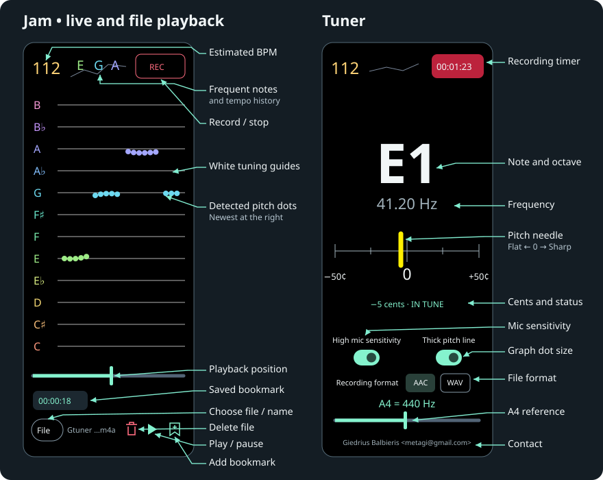
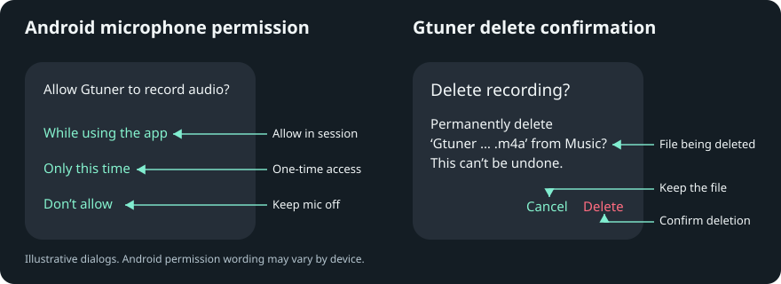

# Gitune

An offline Android tuner, pitch and tempo monitor, and practice recorder. Built to help musicians hear and improve their intonation, see which notes recur in a jam, and review passages without having to watch the screen while playing.

[Download the Android APK](https://github.com/balbgied/Gitune/releases/latest) · [Illustrated user guide](#screens-at-a-glance) · [Report an issue](https://github.com/balbgied/Gitune/issues)

## Use it

1. Download the APK from **Assets** on the GitHub release and open it on an Android 11 or newer device. If Android asks, allow installation from the browser or file manager you used. You can turn that permission back off afterward.
2. Open Gitune and allow microphone access for live tuning and recording. Playback of existing files does not require it.
3. Swipe between **Jam** and **Tuner**. In Jam, tap **REC** before playing and the red timer to stop. The saved take appears below the graph: tap **Play** to listen back and add bookmarks to passages you want to practise.

Gitune keeps the screen awake while the app is on screen, even when you’re not recording. Your normal screen timeout applies again when you leave Gitune.

The guide below describes the current development build. The latest release APK may not yet include the Playlist controls or updated Jam labels.

**Updating from Gtuner?** Install Gitune over the original GitHub build to keep your settings and bookmarks. Existing recordings keep their filenames; new takes start with `Gitune`.

## Why I built it

I wanted a live tuner to help me improve my intonation, and a way to see which notes I kept coming back to in a jam so I could work out what scale I was playing. But when I practise, I like to close my eyes and focus on the sound itself: the tone, the pitch, and how the note feels. Recording lets me do that without watching a screen. Afterwards I can listen back, see exactly where the pitch tends to drift, and work on those passages. The loop is simple: play, listen back, adjust, and try again.

## Screens at a glance

Gitune has two screens: **Jam** and **Tuner**. File review lives inside Jam, not on a separate screen. The illustrations use example readings and filenames; they are not device screenshots.



### Jam: live playing and file review

- **BPM and tempo history:** The number at top left is the estimated beats per minute. The faint trace to its right shows recent tempo. A dash means there isn’t a reliable estimate. It looks for repeating attacks, so a steady drum beat or a few evenly spaced claps or syllables usually produces a reading after a couple of seconds. The same estimate is calculated during file review.
- **Note labels:** All twelve semitones are labeled along the right edge of the pitch graph, including B♭, A♭, F♯, E♭, and C♯. Label brightness tracks how often each note was detected over roughly the previous ten seconds: the most frequent notes are brightest, and unused notes fade to black. Use them as clues to a scale; Gitune does not name the key or scale automatically.
- **REC / red timer:** Tap **REC** to start a mic recording, then tap the red elapsed-time button to stop. Wait for **Saving** to finish. The take appears below the graph automatically; it does not autoplay.
- **Pitch graph:** Shows the last eight seconds. New detections appear at the right and move left. A dot above a guide is sharp, a dot below is flat, and a centered dot is in tune. The same note in different octaves shares a row. All twelve semitones are labeled on the right edge. Live Jam and file review can plot up to three dots at the same time. Dimmer dots are hints from strong tonal peaks, including overtones and other instruments, and count toward the note-label brightness. Most hints don’t affect the Tuner needle, but a single strong hint that persists for a few frames can be used as a fallback when the periodicity check is unsure. Blank areas mean there wasn’t enough evidence to plot a note.
- **Seek slider and bookmarks:** Drag the slider or tap a bookmark to move within the selected file. Tap the bookmark icon to mark the current position (up to four marks per file); long-press a mark to remove it.
- **File and playback controls:** Tap **File** to open Android’s picker. The filename shows what is selected. **Play/Pause** switches between file playback and live mic display; at the end of playback, the graph also returns to live automatically. While playing, BPM, note-label brightness and pitch dots come from the file, not the mic, using the same multi-note analysis as live Jam. **REC** stops playback and starts a new mic recording.
- **Trash:** Opens a confirmation dialog before deleting the recording from storage. For imported files with a linked original, read the dialog carefully: confirmation can delete both the original and the Music copy. If Android blocks deletion of the original, Gitune keeps the copy and reports the problem.

### Tuner: check a sustained note

- **Note and frequency:** Play one note at a time. The large label shows the nearest note (including sharps and flats) and its octave, with measured frequency in hertz beneath it.
- **Yellow needle and cents:** Left of zero is flat; right is sharp. The reading also shows the signed offset in cents and a status. Gitune reports **IN TUNE** within ±5 cents of center. A semitone is 100 cents.
- **Adaptive pitch sensitivity:** Gitune automatically adjusts the live detection threshold to recent sound levels. This changes pitch analysis only, not microphone gain or recording level. The Tuner needle prefers a clear repeating pitch; when noise prevents a periodic lock, a single sustained tonal peak is confirmed over a few frames and can drive the needle instead.
- **Thick pitch line:** On by default for 12 dp dots; turn it off for 4 dp dots. It applies to both live and file graphs. Dots are never connected.
- **Playlist:** On the **Tuner** screen, tap **Playlist**, paste a plain-text setlist with one song per line, and tap **Save**. Use the checkbox next to **Playlist** to show or hide the setlist without deleting it. When enabled, the setlist appears in dim gray behind the Jam pitch graph during live playing and playback. About twelve lines fit at once; swipe vertically on the graph for longer lists. Long titles are shortened on screen. The text and checkbox setting stay on the device.
- **Recording format:** **AAC** is the default (mono AAC-LC, 128 kbps, `.m4a`). Choose **WAV** for lossless recording. This affects new takes, not files already saved.
- **A4 reference:** Adjusts the tuning reference for both screens from 415 to 466 Hz; the default is 440 Hz. The setting is saved.

## Permissions, files and privacy



| What Android asks for | What Gitune does with it |
| --- | --- |
| **Microphone** (`RECORD_AUDIO`) | Required for live pitch, live tempo and recording. Tap **Enable microphone** or **REC** and allow access while using the app. If denied, you can still open and play existing files. To enable it later, go to **Settings → Apps → Gitune → Permissions → Microphone**. |
| **File picker access** | **File** uses Android’s picker. Access is scoped to the file you select; no broad storage permission is requested. Gitune copies imports to shared **Music/** and keeps access to the original when Android grants it, so it can honor a confirmed deletion. |
| **Other permissions** | The app does not request network, location, camera or contacts permissions. Recording, analysis and playback run on the device. |

New recordings are saved to shared **Music/**, where you can find them using Android’s Files app. Review can open AAC (`.m4a` or `.aac`), MP3, FLAC and WAV. Keep Gitune visible while recording and let it finish saving after you stop; it stops recording when it is no longer visible. If the app is killed before an AAC file is finalized, that file may not be playable.

## A practice session

1. Open **Tuner**, play one sustained note, and use the yellow needle to check your starting intonation.
2. Swipe to **Jam**, tap **REC**, and play with your eyes closed. Focus on tone and pitch rather than the graph.
3. Tap the red timer to stop. Once the take appears below the graph, tap **Play** and listen for the places that felt uncertain.
4. Watch where the dots drift above or below their guides. Bookmark difficult passages, then practise them again and compare the next take.

Use one clearly audible note at a time for precise tuning. Live Jam can suggest a prominent pitch in a mix, but a single phone mic can’t reliably separate your instrument from the band. For feedback on your own playing, place the phone closer to you rather than on the floor. Use the graph to guide your listening, not replace it.

## Build from source

Open the project in Android Studio with **Android SDK Platform 37** installed and use a Gradle JDK compatible with Android Gradle Plugin 9.2 (JDK 17 or newer; Android Studio’s bundled JDK works). Sync and run the `app` configuration, or build from a terminal:

```sh
./gradlew :app:assembleDebug
```

On Windows use `gradlew.bat`. The APK is built at `app/build/outputs/apk/debug/app-debug.apk`. The app uses Kotlin, Jetpack Compose and Android media APIs. Compose previews in `MainActivity.kt` use example data rather than live audio.

The [working specification](music_analyzer_android_spec_v0.1.md) and [early mockups](docs/prototype) are historical design material, not descriptions of the current interface.

## License and contact

Gitune is distributed under the [GNU General Public License v3.0](LICENSE), without warranty. Maintained by Giedrius Balbieris (<metagi@gmail.com>).
