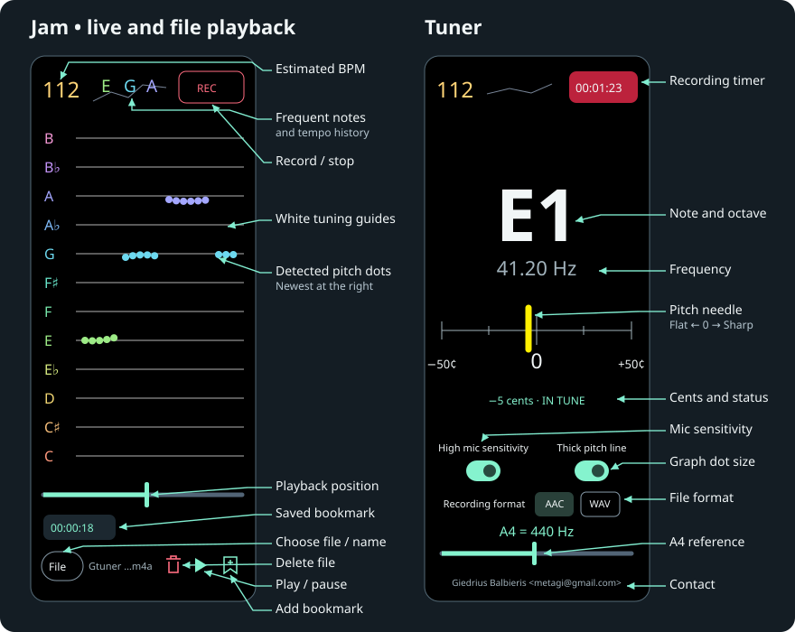
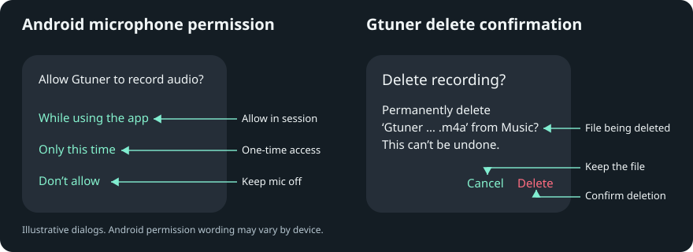

# Gitune for Android

## Why I built it

I wanted a live tuner to help me improve my intonation, and a way to see which notes I kept coming back to in a jam so I could work out what scale I was playing. But when I practise, I like to close my eyes and focus on the sound itself: the tone, the pitch, and how the note feels. Recording lets me do that without watching a screen. Afterwards I can listen back, see exactly where the pitch tends to drift, and work on those passages. The loop is simple: play, listen back, adjust, and try again.

## Screens at a glance

Gitune has two screens. Swipe left or right to switch between **Jam** and **Tuner**. File review lives inside Jam, not on a separate screen. The illustrations use example readings and filenames; they are not device screenshots.

### Jam: live playing and file review

- **BPM and tempo history:** The number at top left is the estimated beats per minute. The faint trace behind the note names shows recent tempo. A dash means there isn’t a reliable estimate. Try at least four evenly spaced claps or short syllables to check it.
- **Frequent notes:** The colored names in the header show up to four of the most frequently detected notes over roughly the previous ten seconds. Use them as clues to a scale; Gitune does not name the key or scale automatically.
- **REC / red timer:** Tap **REC** to start a mic recording, then tap the red elapsed-time button to stop. Wait for **Saving** to finish. The take appears below the graph automatically; it does not autoplay.
- **Pitch graph:** Shows the last eight seconds. New detections appear at the right edge and move left. Each colored dot is one detection, not an interpolated line. Above a white guide means sharp, below means flat, and centered means in tune for that note. The same note in different octaves shares a row. Blank areas mean no usable pitch was detected.
- **Seek slider and bookmarks:** Drag the slider or tap a bookmark to move within the selected file. Tap the bookmark icon to mark the current position (up to four marks per file); long-press a mark to remove it.
- **File and playback controls:** Tap **File** to open Android’s picker. The filename shows what is selected. **Play/Pause** switches between file playback and live mic display; at the end of playback, the graph also returns to live automatically. While playing, BPM, frequent notes and pitch dots come from the file, not the mic. **REC** stops playback and starts a new mic recording.
- **Trash:** Opens a confirmation dialog before deleting the recording from storage. For imported files with a linked original, read the dialog carefully: confirmation can delete both the original and the Music copy. If Android blocks deletion of the original, Gitune keeps the copy and reports the problem.

### Tuner: check a sustained note

- **Note and frequency:** Play one note at a time. The large label shows the nearest note and its octave (for example, E1), with measured frequency in hertz beneath it.
- **Yellow needle and cents:** Left of zero is flat; right is sharp. The reading also shows the signed offset in cents and a status. Gitune reports **IN TUNE** within ±5 cents of center. A semitone is 100 cents.
- **High mic sensitivity:** On by default. It lowers the live pitch detection threshold by about 18 dB; it does not boost hardware mic gain, recording level or tempo sensitivity. Turn it off if quiet background sounds trigger unwanted detections.
- **Thick pitch line:** On by default for 12 dp dots; turn it off for 4 dp dots. It applies to both live and file graphs. Dots are never connected.
- **Recording format:** **AAC** is the default (mono AAC-LC, 128 kbps, `.m4a`). Choose **WAV** for lossless recording. This affects new takes, not files already saved.
- **A4 reference:** Adjusts the tuning reference for both screens from 415 to 466 Hz; the default is 440 Hz. The setting is saved.
- **Contact:** Giedrius Balbieris · [metagi@gmail.com](mailto:metagi@gmail.com).

## Permissions, files and privacy

| What Android asks for | What Gitune does with it |
| --- | --- |
| **Microphone** (`RECORD_AUDIO`) | Required for live pitch, live tempo and recording. Tap **Enable microphone** or **REC** and allow access while using the app. If denied, you can still open and play existing files. To enable it later, go to **Settings → Apps → Gitune → Permissions → Microphone**. |
| **File picker access** | **File** uses Android’s picker. Access is scoped to the file you select; no broad storage permission is requested. Gitune copies imports to shared **Music/** and keeps access to the original when Android grants it, so it can honor a confirmed deletion. |
| **Other permissions** | The app does not request network, location, camera or contacts permissions. Recording, analysis and playback run on the device. |

New recordings are saved to shared **Music/**, where you can find them using Android’s Files app. Review can open AAC (`.m4a` or `.aac`), MP3, FLAC and WAV. Keep Gitune visible while recording and let it finish saving after you stop; it stops recording when it is no longer visible. If the app is killed before an AAC file is finalized, that file may not be playable.

## A practice session

1. Open **Tuner**, play one sustained note, and use the yellow needle to check your starting intonation.
2. Swipe to **Jam**, tap **REC**, and play with your eyes closed. Focus on tone and pitch rather than the graph.
3. Tap the red timer to stop. Once the take appears below the graph, tap **Play** and listen for the places that felt uncertain.
4. Watch where the dots drift above or below their guides. Bookmark difficult passages, then practise them again and compare the next take.

Gitune works best with one clearly audible note at a time. A dense mix, noise or overtones can produce missing or misleading detections. Use the graph to guide your listening, not replace it.
